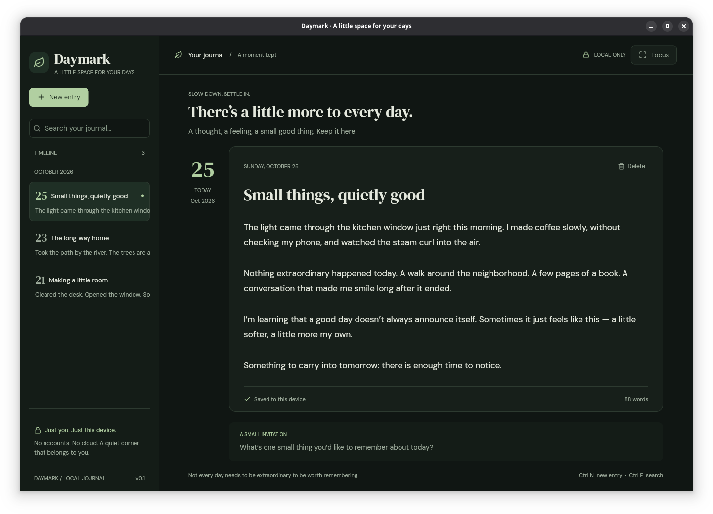

# Daymark 🌿

A quiet, local-only desktop journal built with **Rust + Freya**, with a dark, sage-green native interface, not a webview.



## The MVP

- Write and edit plain-text entries, with multiline text, selection, undo/redo, and word count.
- Autosave each committed change to a local SQLite database.
- Browse a month-grouped, newest-first timeline in the sidebar.
- Search titles and bodies; matching is literal and Unicode-lowercased.
- Hide the timeline for focus mode. Confirm before permanently deleting an entry.
- Embedded **DM Sans + DM Serif Display**, reusable UI primitives, and a custom dark-green theme.
- No account, telemetry, sync, remote fonts, network requests, or calendar.
- Failed saves retain the draft, block navigation/deletion/normal window close, and display an error.

**Local-only does not mean encrypted.** The database is plaintext. Protect it with your OS account and disk encryption. See [privacy](docs/PRIVACY.md) before storing sensitive writing.

## Run

Install a current stable Rust toolchain and the [native prerequisites](docs/DEVELOPMENT.md).

```sh
cargo run --locked
```

For an isolated journal, use a **dedicated** local directory (not your home directory or this checkout):

```sh
cargo run --locked -- --data-dir /absolute/path/to/daymark-data
cargo run --locked -- --help
```

Daymark otherwise uses its OS local application-data directory, and creates `journal.sqlite3` there. Click **“Just you. Just this device.”** to see its exact location and privacy notes. Unix directory/file permissions are restricted to `0700`/`0600`.

**Existing journals:** The default directory now uses Daymark's name. Existing databases remain compatible and are never moved or deleted automatically. To reopen a journal from a previous installation, run `cargo run --locked -- --data-dir /absolute/path/to/existing-journal-directory`.

**Shortcuts:** Ctrl+N / Cmd+N new entry · Ctrl+F / Cmd+F search · Ctrl+S / Cmd+S save/retry. Tab navigates controls; Escape leaves the writing area. Standard text-editor shortcuts are provided by Freya.

## Why SQLite?

SQLite is the single source of truth. [`rusqlite`](https://docs.rs/rusqlite/) with bundled SQLite gives the small MVP transactions, revision checks, schema versioning and portable disk storage without an async runtime or database server. No SQLx or compile-time database macros are used. [Read the alternatives assessment](docs/STORAGE.md).

## Check

```sh
cargo fmt --check
cargo clippy --locked --all-targets -- -D warnings
cargo test --locked --all-targets
# Regenerate the headless UI test screenshot from fictional test data:
cargo test --locked render_documentation_screenshot -- --ignored
```

The app starts empty; test fixtures are never seeded into your real journal.

## Start reading

- [Documentation index](docs/README.md)
- [Architecture](docs/ARCHITECTURE.md) · [Design system](docs/DESIGN.md)
- [Development](docs/DEVELOPMENT.md) · [Testing](docs/TESTING.md)
- [Privacy](docs/PRIVACY.md) · [Safe backup and recovery](docs/BACKUP.md)
- [Research and upstream sources](docs/RESEARCH.md)
- [Reviewed project skills](docs/SKILLS_REVIEW.md) · [Agent rules](AGENTS.md)
- [MVP scope and limitations](docs/PRODUCT.md) · [Roadmap](docs/ROADMAP.md)

This is an MVP, not a hardened vault or packaged release. Calendar, rich text/Markdown rendering, attachments, import/export, sync, encryption and installers are intentionally absent.
